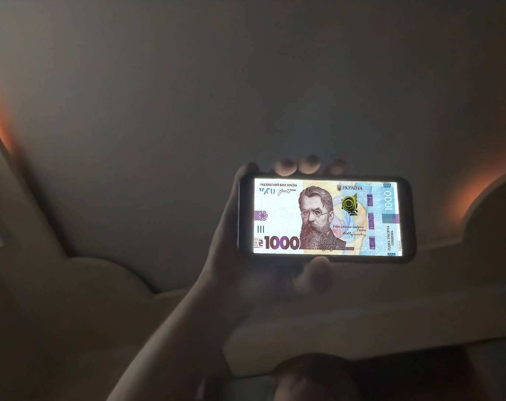
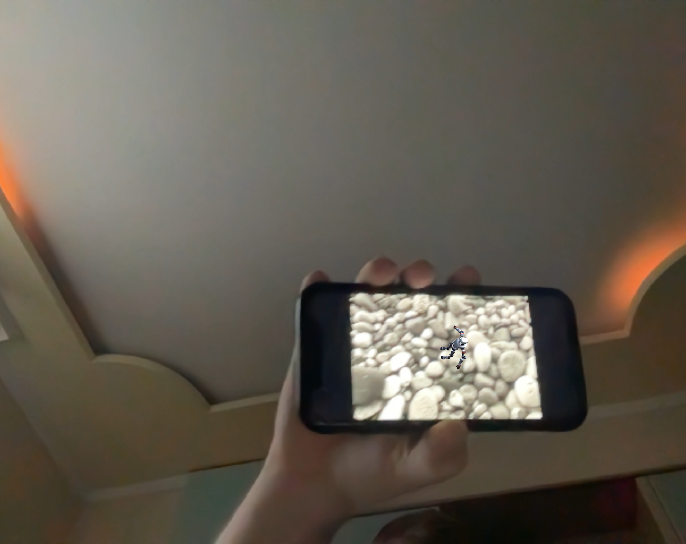

# Звіт з лабораторної роботи № 1

**Дисципліна:** Технології VR/AR
**Тема:** Вступ у Unity Engine. Доповнена реальність. Використання Vuforia Engine. Цілі «зображення» (Image Targets).
**Виконав:** ____________________ (ПІБ, група)

## Мета роботи

Ознайомитися з середовищем Unity, навчитися створювати застосунок доповненої реальності з використанням Vuforia Engine та цілей-зображень (Image Targets), зібрати його під Android. Реалізувати AR-сценарій: при наведенні камери на зображення купюри **100 гривень** на її місці одразу з'являється зображення купюри **1000 гривень**.

## Середовище

| Компонент | Версія |
|---|---|
| Unity | 6000.6.10f1 (Apple Silicon, Built-in Render Pipeline) |
| Vuforia Engine | 11.4.4 |
| Цільова платформа | Android (IL2CPP, ARM64, minSdk 26, OpenGLES3, Landscape Left) |
| Тест у редакторі | Vuforia Play Mode, вебкамера Mac (FaceTime HD) |

## Хід роботи

1. **Створення проєкту.** Створено 3D-проєкт `AR_Lab1`, підключено пакет Vuforia Engine (`com.ptc.vuforia.engine` 11.4.4) через Package Manager (tgz у `Vuforia/`), у `VuforiaConfiguration` вказано ліцензійний ключ Vuforia.
2. **Сцена.** Сцена `Main` містить `ARCamera` (компоненти `VuforiaBehaviour`, `DefaultInitializationErrorHandler`), напрямлене світло та об'єкт `Targets` зі скриптом `RuntimeTargets`.
3. **Цілі-зображення.** Скрипт `RuntimeTargets` після старту Vuforia (`VuforiaApplication.OnVuforiaStarted`) створює цілі з текстур викликом `ObserverFactory.CreateImageTarget(texture, widthInMeters, name)`, без бази з Target Manager. Для кожної цілі додається `DefaultObserverEventHandler`, що вмикає/вимикає контент при втраті й знаходженні цілі.
   - **Ціль `uah100`:** зображення купюри 100 грн (ширина цілі 0,15 м). Поверх неї розміщено `Quad` з текстурою купюри 1000 грн (матеріал `Unlit/Texture`), що повністю закриває ціль.
   - **Ціль `stones`:** маркер із заняття; на ньому стоїть 3D-модель Robot Kyle.
4. **Налаштування збірки.** `SceneBuilder` (editor-скрипт) створює сцену й налаштовує Player Settings: IL2CPP, ARM64, minSdk 26, OpenGLES3, ідентифікатор `com.lab.arlab1`; збірка запускається з терміналу методом `SceneBuilder.BuildAll`.
5. **Build під Android.** Зібрано `build/AR_Lab1.apk` (≈ 50 МБ).
6. **Перевірка.** Запуск у Play Mode з вебкамерою: на камеру показували телефон із зображенням купюри 100 грн та маркера `stones`. У консолі Unity для цілей з'являлися статуси `TRACKED` / `EXTENDED_TRACKED`.

## Результати

Купюра 100 грн розпізнається, поверх неї відображається купюра 1000 грн:

Маркер `stones` розпізнається, на ньому з'являється модель Robot Kyle:

Зібраний застосунок: [`build/AR_Lab1.apk`](build/AR_Lab1.apk).

**Обмеження.** APK зібрано успішно, але на Android-пристрої не запускався (телефона з Android немає). Роботу AR підтверджено в Play Mode Vuforia з вебкамерою комп'ютера.

## Висновки

**Особливості створення AR-застосунків.** AR-застосунок у Unity складається з AR-камери, що отримує відеопотік і визначає положення цілей, та віртуального контенту, прив'язаного до цілі. Vuforia порівнює кадр з камери з ознаками (feature points) зображення-цілі, тому якість розпізнавання залежить від самої цілі: вона має бути контрастною, детальною, без симетрії та повторюваних візерунків, а також від освітлення й різкості кадру. Купюра добре підходить як ціль, бо має багато дрібних деталей і водяних знаків. Для роботи Vuforia потрібен ліцензійний ключ, а на macOS — дозвіл на доступ до камери для самого Unity. Розмір цілі в метрах треба вказувати коректно, інакше контент матиме хибний масштаб. Цілі можна створювати як у Target Manager (база даних), так і з коду в рантаймі з текстури, як зроблено в цій роботі.

**Розробка ігрових середовищ у Unity.** Світ у Unity складається зі сцен, а сцена — з ієрархії об'єктів `GameObject`, функціональність яких задають компоненти (`Transform`, `Camera`, `Renderer`, скрипти `MonoBehaviour`). Повторно використовувані об'єкти оформлюють як префаби. Сцену можна збирати вручну в редакторі або програмно, через editor-скрипти й код у рантаймі. Редактор дозволяє швидко перевіряти результат у Play Mode без збірки на пристрій.

**Реалізація фізики в Unity.** Фізику забезпечують компоненти `Rigidbody` (динаміка: маса, сила тяжіння, швидкість) і `Collider` (форма для зіткнень), обчислення виконуються з фіксованим кроком (`FixedUpdate`). В AR важливо, що одиниця Unity дорівнює одному метру, тому реальні розміри цілі й контенту узгоджують з фізичними розмірами. У цій лабораторній фізика не використовувалась: колайдер із накладеного `Quad` видалено, щоб контент слугував лише візуальним елементом.

## Посилання

Репозиторій з проєктом: https://github.com/djkey245/labs/tree/main/vr-ar-technologies/lab-01/submission

Проєкт Unity: `AR_Lab1/`, зібраний застосунок: `build/AR_Lab1.apk`, скріни запуску: `media/`.
