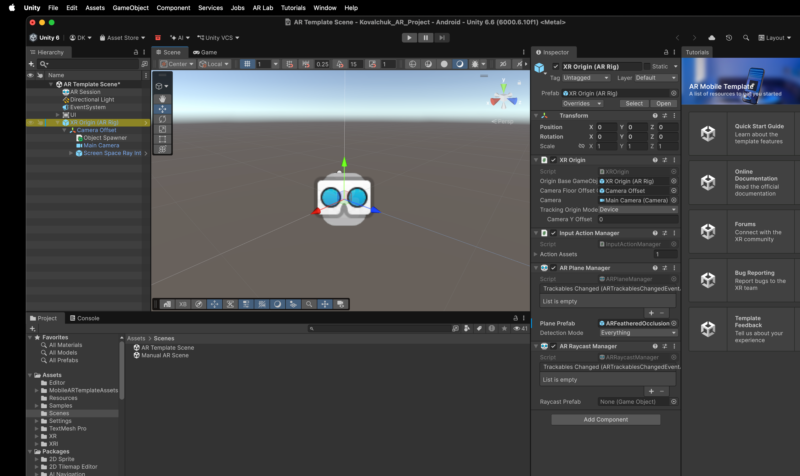
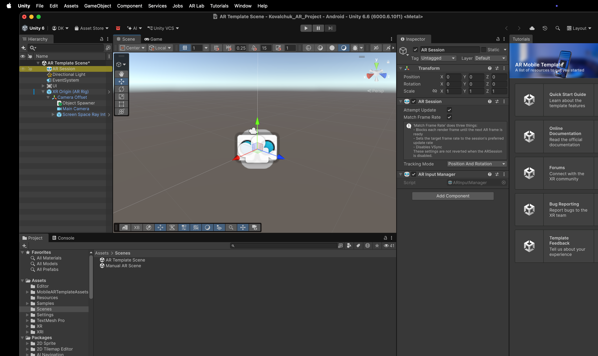
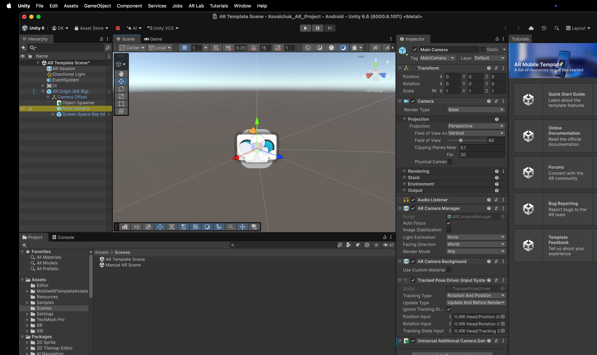
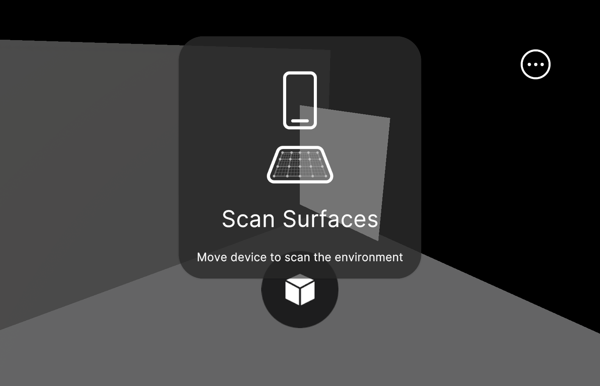
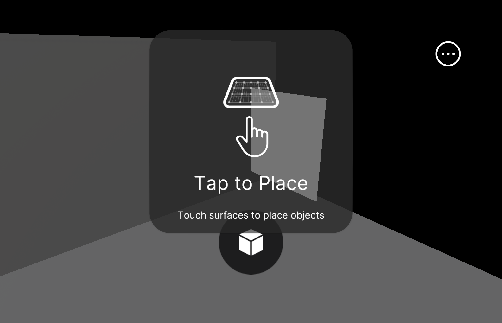

# Звіт з лабораторної роботи № 2

**Дисципліна:** Технології VR/AR
**Тема:** Вступ у Unity Engine. Доповнена реальність. Використання шаблону AR Mobile Template.
**Виконав:** Ковальчук Дмитро Олексійович, група ПІ-23

## Мета роботи

Ознайомитися зі шаблоном **AR Mobile** у Unity: створити проєкт за шаблоном, налаштувати його під Android, дослідити структуру AR-сцени (XR Origin, AR Session), запустити сцену в режимі **XR Simulation** без пристрою, зібрати застосунок під Android (`.apk`) і навчитися створювати AR Session та XR Origin вручну.

## Середовище

| Компонент | Версія |
|---|---|
| Unity | 6000.6.10f1 (Apple Silicon), Universal Render Pipeline |
| Шаблон | AR Mobile (`com.unity.template.ar-mobile` 2.1.3) |
| AR Foundation / ARCore XR Plugin / ARKit XR Plugin | 6.6.2 |
| XR Plugin Management | 4.7.0 |
| XR Interaction Toolkit | 3.6.1 |
| Проєкт | `Kovalchuk_AR_Project` |

## Хід роботи

1. **Проєкт за шаблоном.** Створено проєкт `Kovalchuk_AR_Project` із шаблону AR Mobile (вміст шаблону розгорнуто так само, як це робить Unity Hub, і проєкт відкрито в Unity 6000.6).
2. **Пакети (Package Manager).** У проєкті встановлено:
   - **AR Foundation** — кросплатформений API доповненої реальності (`ARSession`, `ARCameraManager`, `ARPlaneManager`, `ARRaycastManager`): однаковий код для Android та iOS;
   - **Google ARCore XR Plugin** — провайдер AR Foundation для Android (трекінг руху, пошук площин, ARCore);
   - **Apple ARKit XR Plugin** — провайдер AR Foundation для iOS;
   - **XR Plugin Management** — керує вибором і завантаженням XR-провайдерів (loaders) для кожної платформи, зокрема провайдера XR Simulation для редактора;
   - **XR Interaction Toolkit** — взаємодія з AR-об'єктами (дотики, жести, спавн об'єктів).
3. **Налаштування Android** (Project Settings → Player → Android):
   - графічний API: лише **OpenGLES3** (Vulkan прибрано, як вимагає методичка);
   - Scripting Backend: **IL2CPP**, архітектура **ARM64**;
   - мінімальний API: **26** (Android 8.0), ідентифікатор застосунку `com.lab.arlab2`;
   - у XR Plug-in Management для Android увімкнено провайдер ARCore.
4. **Сцена.** Сцену з шаблону збережено як `Assets/Scenes/AR Template Scene.unity` і додано в Build Settings.
5. **Дослідження сцени.** Структура `AR Template Scene` (скріни нижче):
   - **AR Session** — компоненти `AR Session` (керує життєвим циклом AR: Attempt Update, Match Frame Rate, Tracking Mode) та `AR Input Manager`;
   - **XR Origin (AR Rig)** — початок системи координат AR: компонент `XR Origin` (посилання на Camera Offset і Main Camera, Tracking Origin Mode = Device), `Input Action Manager`, `AR Plane Manager` (пошук площин), `AR Raycast Manager` (промені до площин);
   - **Main Camera** (тег `MainCamera`) — дочірній об'єкт Camera Offset з компонентами `Camera`, `AR Camera Manager` (керує камерою пристрою), `AR Camera Background` (виводить відео з камери як фон), `Tracked Pose Driver` (переносить позу пристрою на камеру);
   - **Object Spawner**, **Screen Space Ray Interactor** — спавн і взаємодія з об'єктами дотиками;
   - **UI** — меню створення об'єктів і підказки для користувача (`ARTemplateMenuManager`, `GoalManager`).
6. **XR Simulation.** У Play Mode сцена працює із симульованим AR-середовищем (XR Simulation, XR Plug-in Management → провайдер Simulation): камера обертається в симульованій кімнаті, `AR Plane Manager` знаходить площини, а ряд об'єктів (XR Interaction Manager, Trackables) існує лише під час Play Mode. Шаблон показує вітальний екран, потім підказки «Scan Surfaces» та «Tap to Place».
7. **Створення AR Session і XR Origin вручну** (додаток методички). У новій порожній сцені `Manual AR Scene.unity` додано **GameObject → XR → AR Session** та **GameObject → XR → XR Origin (Mobile AR)**. Утворена ієрархія: `AR Session` [ARSession, ARInputManager]; `XR Origin (Mobile AR)` [XROrigin, InputActionManager, ARPlaneManager, ARRaycastManager] → `Camera Offset` → `Main Camera` [Camera, ARCameraManager, ARCameraBackground, TrackedPoseDriver] — той самий мінімальний набір, що й у шаблонній сцені.
8. **Збірка Android.** Зібрано `build/Kovalchuk_AR_Project.apk` (≈ 39 МБ): IL2CPP, ARM64.

## Результати

Структура AR-сцени в редакторі:

Запуск у XR Simulation (Game view):

Зібраний застосунок: [`build/Kovalchuk_AR_Project.apk`](build/Kovalchuk_AR_Project.apk).

**Обмеження.** APK зібрано успішно, але на Android-пристрої не запускався (телефона з Android немає). Роботу сцени підтверджено в Play Mode з XR Simulation.

## Висновки

**Особливості створення AR-застосунків.** AR-застосунок у Unity будується на **AR Foundation**, що дає єдиний API над платформними провайдерами (ARCore на Android, ARKit на iOS); провайдери підключає XR Plugin Management. Мінімальна AR-сцена складається з двох об'єктів: **AR Session** (життєвий цикл AR) та **XR Origin** з камерою (**AR Camera Manager**, **AR Camera Background**, **Tracked Pose Driver**): камера пристрою стає віртуальною камерою, а її поза оновлюється трекінгом. Площини та точки (trackables) виявляються під час роботи на пристрої, тому для перевірки без телефона використовують **XR Simulation**. Для Android потрібні IL2CPP, ARM64 і графічний API без Vulkan.

**Розробка ігрових середовищ у Unity.** Світ складається зі сцен, а сцена — з ієрархії `GameObject` із компонентами. Шаблон готує повну сцену (AR, UI, спавн об'єктів), яку можна змінювати в редакторі й повторно використовувати через префаби. Редактор дозволяє перевіряти результат у Play Mode без збірки на пристрій; об'єкти можна створювати як у Hierarchy, так і кодом.

**Реалізація фізики в Unity.** Фізику задають компоненти `Rigidbody` (маса, гравітація) та `Collider`; розрахунок виконується з фіксованим кроком (`FixedUpdate`). В AR одиниця світу дорівнює одному метру, тому розміри й положення об'єктів узгоджують з реальним світом. У шаблоні об'єкти розміщуються по променях до знайдених площин (`AR Raycast Manager`, `XRRayInteractor`), а взаємодія з ними (рух, обертання, масштаб) реалізована через XR Interaction Toolkit.

## Посилання

Репозиторій з проєктом: https://github.com/djkey245/labs/tree/main/vr-ar-technologies/lab-02/submission

Проєкт Unity: `Kovalchuk_AR_Project/`, зібраний застосунок: `build/Kovalchuk_AR_Project.apk`, скріни: `media/`.
