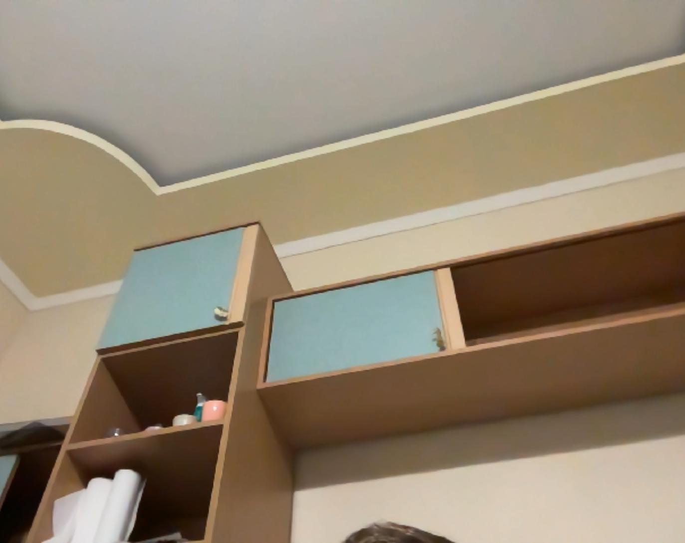
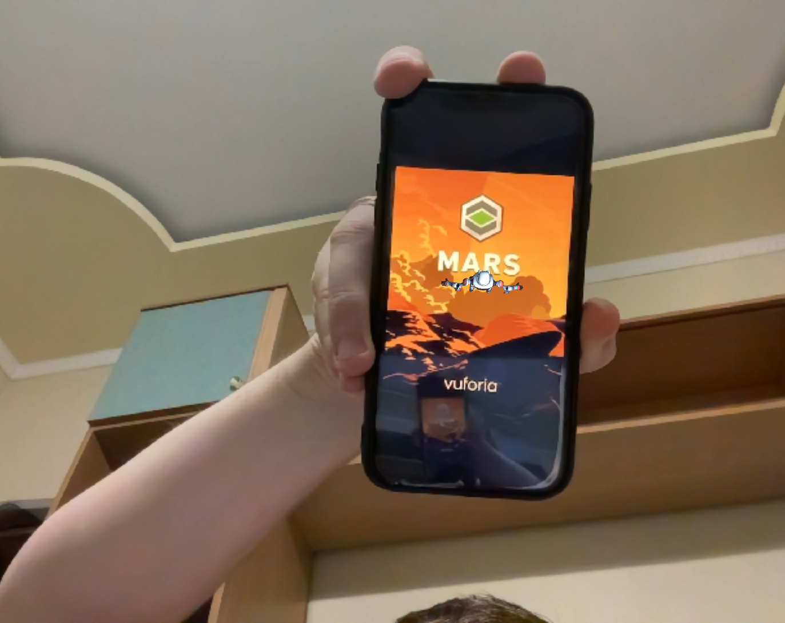
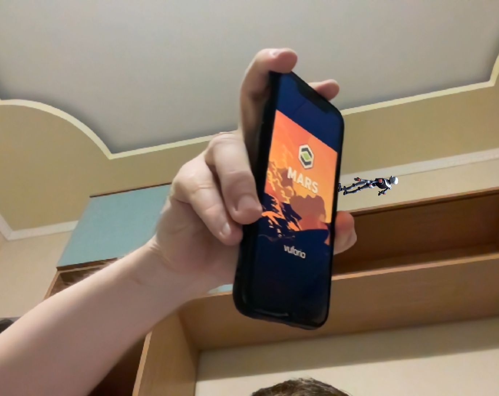

# Звіт з лабораторної роботи № 4

**Дисципліна:** Технології VR/AR
**Тема:** Vuforia Engine: Multi Target (відстеження об'ємного об'єкта — коробки MarsBox).
**Виконав:** Ковальчук Дмитро Олексійович, група ПІ-23

## Мета роботи

Навчитися створювати в Vuforia Target Manager базу з **Multi Target** (коробка з шести зображень-граней), імпортувати її в Unity, розмістити 3D-модель як дочірній об'єкт Multi Target, налаштувати проєкт під Android та зібрати `.apk`.

## Середовище

| Компонент | Версія / значення |
|---|---|
| Unity | 6000.6.10f1 (Apple Silicon), Built-in Render Pipeline |
| Vuforia Engine | 11.4.4 (`com.ptc.vuforia.engine`) |
| Android | IL2CPP, ARM64, OpenGLES3, minSdk 29, `com.lab.arlab4` |
| Проєкт | `AR_Lab4` |
| База Vuforia | `AR_VF_MultiDB`, ціль `marsbox` |

## Хід роботи

1. **База у Target Manager.** На порталі Vuforia створено базу типу *Device* `AR_VF_MultiDB`. Додано ціль типу **Multi Target** `marsbox` з шести зображень MarsBox (Front, Back, Left, Right, Top, Bottom). Розміри коробки Vuforia бере з пропорцій зображень граней: Front/Back 240×320 (3:4), Left/Right 120×320, Top 320×160, Bottom 900×450 (2:1) — коробка **0,12 × 0,16 × 0,06 м** (ширина × висота × довжина). Базу завантажено для Unity (`.unitypackage` з `.dat` та `.xml`).
2. **Проєкт.** Створено проєкт `AR_Lab4`, встановлено Vuforia Engine 11.4.4 з локального пакета, імпортовано базу: `Assets/StreamingAssets/Vuforia/AR_VF_MultiDB.{dat,xml}`.
3. **Сцена `Main`.**
   - **ARCamera** — камера з компонентом `VuforiaBehaviour` (і `DefaultInitializationErrorHandler`);
   - **Multi Target** (`GameObject → Vuforia Engine → Multi Target`): у полях *Database* = `AR_VF_MultiDB`, *Target* = `marsbox`; розмір береться з бази;
   - **3D-модель** — Robot Kyle, дочірній об'єкт Multi Target, стоїть на верхній грані коробки (висота моделі 0,07 м);
   - `DefaultObserverEventHandler` на Multi Target показує модель лише коли ціль відстежується.
4. **Налаштування Android.** IL2CPP, ARM64, лише OpenGLES3 (без Vulkan), орієнтація Landscape Left, ліцензійний ключ Vuforia у `VuforiaConfiguration`. `MaxSimultaneousImageTargets = 1` (Multi Target рахується як одна ціль). Мінімальний API — 29: Vuforia 11.4.4 не збирається з нижчим.
5. **Збірка.** Зібрано `build/AR_Lab4.apk` (≈ 59 МБ). Сцену та налаштування створює скрипт `Assets/Editor/SceneBuilder.cs`.
6. **Перевірка в Play Mode.** Vuforia працює з вебкамерою Mac. Замість фізичної коробки перед камерою тримали екран телефона з гранню Front. Журнал: `MultiTargetBehaviour 'marsbox'` спочатку `NO_POSE`, після появи грані в кадрі — `TRACKED` (`NORMAL`) протягом усього подальшого тесту.

## Результати

Ціль не в кадрі — моделі немає (`NO_POSE`):

Грань Front у кадрі — ціль `TRACKED`, Robot Kyle з'явився над гранню:

Телефон нахилено — модель залишається прив'язаною до об'ємної цілі й змінює положення разом із нею:

Зібраний застосунок: [`build/AR_Lab4.apk`](build/AR_Lab4.apk).

**Обмеження.**
- APK зібрано успішно, але на Android-пристрої не запускався (телефона з Android немає); роботу підтверджено в Play Mode з вебкамерою.
- У Play Mode показано одну грань (Front), а не повну коробку, тому перехід між гранями не перевірявся.
- Модель Toy Car з Asset Store, яку згадує методичка, недоступна, тож використано Robot Kyle (як у ЛР1).

## Відповіді на контрольні питання

**1. Що таке Multi Target і які його переваги порівняно з Image Target?**
Multi Target — ціль із кількох зображень, розташованих у просторі як грані паралелепіпеда; Vuforia відстежує їх як **один об'єкт** зі спільною системою координат. Переваги: об'єкт видно з будь-якого боку (достатньо, щоб у кадрі була хоча б одна грань); трекінг стабільніший, бо використовується більше ознак; при втраті однієї грані положення береться з інших (extended tracking між гранями); контент можна прив'язати до реального об'ємного предмета, а не до пласкої картинки.

**2. Чому текстури граней мають відповідати співвідношенню сторін?**
Vuforia виводить фізичні розміри коробки з пропорцій зображень граней. Якщо пропорції не збігаються з реальними сторонами предмета, розміри в базі будуть хибними, грані «не зійдуться» в одному об'єкті, а модель зміститься, зміниться її масштаб і з'явиться дрижання.

**3. Де в ієрархії розміщувати 3D-модель?**
Як **дочірній об'єкт Multi Target**. Тоді модель успадковує положення, обертання й масштаб цілі та рухається разом з нею; видимістю керує обробник стану відстеження на Multi Target. У цій роботі `Robot Kyle` — child `MultiTarget`.

**4. Сценарії застосування Multi Target.**
- **Ритейл:** AR на упаковці товару — демонстрація вмісту, інструкція, 3D-огляд, акційні ролики.
- **Промисловість:** підказки з обслуговування та складання на корпусі обладнання, розмітка вузлів.
- **Освіта:** об'ємні моделі (молекула, орган, макет) над кубом-маркером, інтерактивні підручники та настільні ігри.

## Висновки

**Особливості AR-застосунків.** AR-сцена у Vuforia складається з AR-камери та цілі (Image, Cylinder, Multi Target), база якої створюється в Target Manager і підключається як `.dat/.xml`. Multi Target дає прив'язку до об'ємного предмета з будь-якого боку; розмір цілі береться з бази, тому пропорції зображень мають збігатися з реальними гранями. Контент робиться дочірнім до цілі й показується лише під час відстеження. Для Android потрібні IL2CPP, ARM64 і OpenGLES3.

**Розробка ігрових середовищ.** Сцена — це ієрархія `GameObject` з компонентами; AR-контент редактор дозволяє перевіряти в Play Mode з вебкамерою без збірки на пристрій, а збірку й налаштування можна автоматизувати Editor-скриптом.

**Фізика в Unity.** Фізику задають `Rigidbody` та `Collider`, обчислення виконуються з фіксованим кроком (`FixedUpdate`). В AR одиниця світу дорівнює метру, тож розміри цілі (0,12 × 0,16 × 0,06 м) і моделі узгоджені з реальним світом; колайдери з моделі прибрано, бо вона лише відображається над коробкою.

## Посилання

Репозиторій з проєктом: https://github.com/djkey245/labs/tree/main/vr-ar-technologies/lab-04/submission

Проєкт Unity: `AR_Lab4/`, застосунок: `build/AR_Lab4.apk`, скріни: `media/`.
